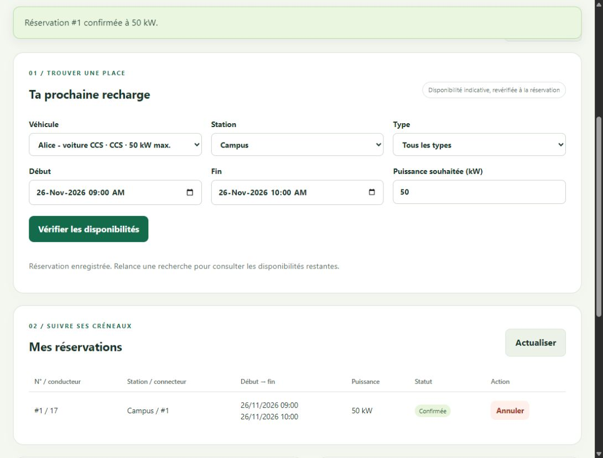

# Validation locale de ChargeSlot

**Date : 25 novembre 2026 (Africa/Lagos, UTC+1).** Les résultats ci-dessous ont été observés localement. Ils ne constituent pas un run GitHub Actions ou une revue humaine par une autre équipe.

## Tests de l'application

Commande exécutée avec le Maven Wrapper fourni : `mvnw.cmd --batch-mode --no-transfer-progress clean verify` (cache Maven de travail isolé). JDK Temurin 21.0.10, Maven 3.9.11, Spring Boot 3.5.16, Windows.

**BUILD SUCCESS - 59 tests exécutés, 0 échec, 0 erreur, 0 ignoré.** JAR exécutable généré et copié à la racine du projet.

| Classe de tests | Tests | Échecs | Erreurs | Ignorés |
|---|---:|---:|---:|---:|
| ConflictPoliciesTest | 26 | 0 | 0 | 0 |
| ElaborationIntegrationTest | 1 | 0 | 0 | 0 |
| ReservationIntegrationTest | 32 | 0 | 0 | 0 |

Preuves : [résumé Maven](validation/maven-verification.txt), [cas exécutés en JSON](validation/tests.json), rapports texte individuels dans `validation/` et sources complètes dans `src/test/java/com/chargeslot/`.

Les vérifications couvrent : chevauchements inclus/englobants/partiels, adjacence, marge, annulation, incompatibilité, maintenance, limites du véhicule/connecteur, capacité partagée, calcul du pic réel, accès par propriétaire/opérateur, CSRF, panne de notification et deux transactions concurrentes.

ElaborationIntegrationTest dérive du scénario nominal : POST valide → 201/CONFIRMED/persistance ; même demande → 409/OVERLAP ; une seule réservation conservée.

## Import intermédiaire décrit dans le guide GitHub

Une copie indépendante contenant **uniquement** les fichiers prévus après l'import UC3 puis UC2 a été compilée et testée. **27 tests passent** (26 politiques + 1 intégration d'Élaboration). Ce contrôle local confirme que le découpage décrit dans le guide n'exige pas les contrôleurs des UC suivants pour fonctionner. Aucun dépôt Git ou run distant n'a été créé pour ce contrôle.

## Diagrammes

Les quatre fichiers PlantUML ont été validés par `-checkonly`, puis rendus en SVG et PNG avec PlantUML 1.2025.10. Les rendus de cas d'utilisation, classes du domaine, classes applicatives et séquence ont été inspectés visuellement.

Le script fourni `scripts/render-diagrams.ps1` a aussi été exécuté avec succès ; son téléchargement vérifie le SHA-256 du JAR PlantUML.

## Vérification dans le navigateur

Application démarrée avec une base mémoire isolée sur `127.0.0.1:8095`, distincte du port de lancement conseillé à l'utilisateur.

- Connexion réelle d'Alice réussie depuis le formulaire.
- Recherche Campus, 50 kW : deux connecteurs CCS proposés.
- Réservation confirmée depuis le bouton : ligne CONFIRMED et notification affichées.
- Annulation depuis le bouton : statut annulé et notification d'annulation affichés.
- Connexion opérateur : formulaires d'administration visibles.
- Création d'une station depuis l'interface : station ajoutée au catalogue.
- Journal de console navigateur : aucune erreur capturée pendant ces parcours.

Captures : [réservation](validation/interface-reservation.jpg), [espace opérateur](validation/interface-operateur.jpg).



## Script de démonstration HTTP

`scripts/demo-api.ps1` a été exécuté contre le serveur de test et termine avec le code 0 :

1. Authentification et récupération des jetons CSRF.
2. Alice réserve 50 kW : CONFIRMED.
3. Bob demande 40 kW sur un autre connecteur : HTTP 409 POWER_ADJUSTMENT_REQUIRED, puissance disponible 30 kW.
4. Bob accepte 30 kW : CONFIRMED.
5. Les notifications locales sont consultables.
6. Les deux réservations créées par le script sont annulées dans le nettoyage.

Le JavaScript de l'interface a également passé `node --check`. Les liens locaux et le contenu de l'archive sont contrôlés au moment de l'emballage.

## Empreinte du binaire livré

SHA-256 de `chargeslot.jar` :

```text
6c809ee7427b1b443cf4e0fd943e8a0aa6abb8515a46206a0dfbd63a78f816ac
```

## Éléments restant à faire par les personnes concernées

- Git/GitHub : initialisation ou import dans le dépôt d'équipe, tickets, branches, PR, tableau, milestones et tags.
- Exécuter et constater la CI **distante** après publication ; le YAML est fourni mais n'a pas été lancé sur GitHub.
- Renseigner les vrais noms des membres et faire réaliser la revue par **une autre équipe**.
- Traiter leurs retours et valider les jalons avec les personnes concernées.

La génération de cette livraison ne certifie pas ces actions externes comme déjà faites.
