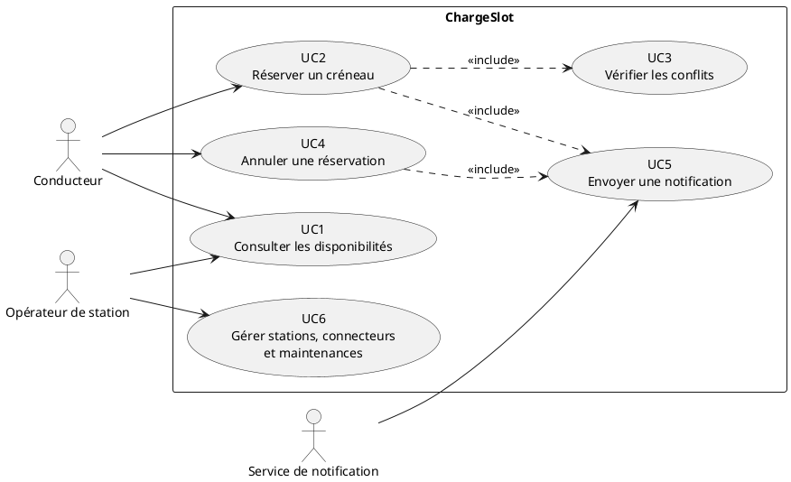
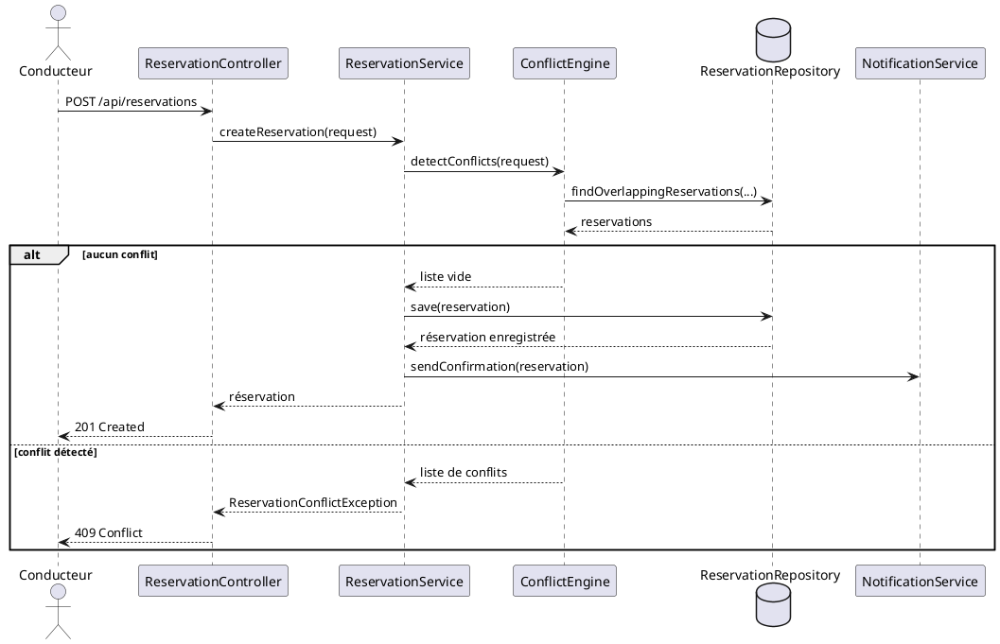

# ChargeSlot — Plan de travail et document de transmission

Ce document contient le plan complet du projet **ChargeSlot** afin qu'un autre membre de l'équipe puisse reprendre et terminer le travail sans refaire l'analyse.

## 1. Présentation du projet

ChargeSlot est une plateforme de réservation de bornes de recharge pour véhicules électriques. Sa particularité est qu'elle ne vérifie pas uniquement la disponibilité temporelle d'un connecteur : elle tient aussi compte de la compatibilité du véhicule, des maintenances et de la puissance électrique totale partagée par la station.

### Vision en cinq lignes

Les conducteurs de véhicules électriques rencontrent des files d'attente et une disponibilité imprévisible des bornes de recharge.  
ChargeSlot permet de consulter et de réserver à l'avance un connecteur compatible avec leur véhicule.  
Le système empêche les doubles réservations et détecte les conflits liés à la maintenance et à la puissance électrique disponible.  
Les opérateurs peuvent administrer les stations, leurs connecteurs et leurs périodes d'indisponibilité.  
La plateforme réduit l'attente, améliore l'utilisation des bornes et rend la recharge plus fiable.

## 2. Acteurs

- **Conducteur** : consulte les disponibilités, réserve et annule un créneau.
- **Opérateur de station** : gère les stations, les connecteurs et les maintenances.
- **Service de notification** : envoie les confirmations et les annulations.
- **Administrateur** : rôle facultatif pouvant être fusionné avec l'opérateur.

## 3. Cas d'utilisation

| ID | Cas d'utilisation | Acteur principal | Priorité |
|---|---|---|---|
| UC1 | Consulter les disponibilités | Conducteur | Haute |
| UC2 | Réserver un créneau de recharge | Conducteur | Très haute |
| UC3 | Vérifier les conflits de réservation | Système | Très haute — risque technique |
| UC4 | Annuler une réservation | Conducteur | Moyenne |
| UC5 | Envoyer une notification | Service de notification | Haute |
| UC6 | Gérer les stations, connecteurs et maintenances | Opérateur | Moyenne |

Relations importantes :

- UC2 inclut obligatoirement UC3.
- UC2 déclenche UC5 après une réservation réussie.
- UC4 déclenche UC5 après une annulation.

## 4. Priorisation détaillée

Échelle : 1 = faible, 5 = très élevé.

| Ordre | UC | Valeur métier | Risque | Impact architecture | Total |
|---:|---|---:|---:|---:|---:|
| 1 | UC3 — Vérifier les conflits | 5 | 5 | 5 | 15 |
| 2 | UC2 — Réserver un créneau | 5 | 4 | 5 | 14 |
| 3 | UC1 — Consulter les disponibilités | 4 | 2 | 3 | 9 |
| 4 | UC5 — Envoyer une notification | 3 | 3 | 3 | 9 |
| 5 | UC6 — Gérer l'infrastructure | 3 | 2 | 3 | 8 |
| 6 | UC4 — Annuler une réservation | 3 | 1 | 2 | 6 |

UC2 et UC3 doivent être traités en premier pour valider l'architecture et maîtriser le risque technique.

## 5. Règles métier et conflits

### 5.1 Capacité électrique

Le connecteur possède une puissance maximale fixe. La voiture possède également une puissance maximale qu'elle peut accepter. La puissance réellement attribuable est limitée par ces deux valeurs et par la puissance encore disponible dans la station.

```text
puissanceAttribuable = min(
    connecteur.maxPowerKw,
    vehicule.maxAcceptedPowerKw,
    puissanceDisponibleStation
)
```

Attributs recommandés :

```text
ChargingStation.maximumPowerKw
Connector.maximumPowerKw
Vehicle.maximumAcceptedPowerKw
Reservation.requestedPowerKw
```

### 5.2 Exemple de conflit de puissance

Une station dispose d'une capacité totale de `80 kW`.

- Une première voiture utilise `50 kW` entre 14 h et 15 h.
- Une seconde voiture demande `40 kW` entre 14 h 30 et 15 h 30 sur un autre connecteur.
- Les deux connecteurs sont disponibles, mais la demande totale atteint `90 kW`.
- Le système doit refuser la seconde réservation, proposer un autre horaire ou proposer une recharge limitée à `30 kW`.

### 5.3 Types de conflits à détecter

1. **Chevauchement temporel** : le même connecteur est déjà réservé.
2. **Incompatibilité** : le type de connecteur ne correspond pas au véhicule.
3. **Maintenance** : la station ou le connecteur est indisponible.
4. **Dépassement de puissance** : les réservations simultanées dépassent la capacité de la station.
5. **Marge opérationnelle** : une marge facultative de dix minutes sépare deux réservations.

Deux intervalles se chevauchent lorsque :

```text
nouveauDebut < ancienneFin ET nouveauFin > ancienDebut
```

Deux créneaux dont l'un finit exactement au début de l'autre ne se chevauchent pas, sauf si la marge opérationnelle est activée.

## 6. Fiche UC2 — Réserver un créneau

**Acteur principal :** Conducteur  
**Objectif :** obtenir une réservation garantie pour un connecteur compatible.  
**Préconditions :** le conducteur, la station et le connecteur existent.  
**Déclencheur :** le conducteur sélectionne un connecteur et un intervalle.

### Scénario nominal

1. Le conducteur consulte les disponibilités.
2. Il choisit une station, un connecteur et un créneau.
3. Il indique la puissance souhaitée.
4. Le système vérifie la validité des dates.
5. Le système vérifie la compatibilité du connecteur.
6. Le système recherche les réservations qui se chevauchent.
7. Le système vérifie les périodes de maintenance.
8. Le système vérifie la puissance totale de la station.
9. Le système enregistre la réservation avec le statut `CONFIRMED`.
10. Le système envoie une confirmation.

### Scénarios alternatifs

- Créneau invalide : retour `400 Bad Request`.
- Station ou connecteur introuvable : retour `404 Not Found`.
- Chevauchement : retour `409 Conflict`.
- Connecteur incompatible : retour `409 Conflict` avec une raison explicite.
- Maintenance : retour `409 Conflict` avec la période concernée.
- Puissance insuffisante : proposition d'un horaire ou d'une puissance différente.

### Postconditions

- En cas de succès, une réservation `CONFIRMED` est enregistrée.
- En cas d'échec, aucune réservation n'est créée.

## 7. Architecture recommandée

### Technologies

- Java 21
- Spring Boot
- Spring Web
- Spring Data JPA
- H2 pour la démonstration, PostgreSQL facultatif
- Maven
- JUnit 5 et MockMvc
- GitHub Actions
- PlantUML

### Architecture en couches

```text
Controller REST
      ↓
Service applicatif
      ↓
Moteur de conflits
      ↓
Repository JPA
      ↓
Base de données
```

Le moteur de conflits peut utiliser le patron **Strategy**. Chaque règle implémente une interface commune `ConflictPolicy` :

```text
ConflictPolicy
├── OverlapPolicy
├── CompatibilityPolicy
├── MaintenancePolicy
└── PowerCapacityPolicy
```

Cette conception permet d'ajouter une règle sans modifier tout le service de réservation.

### Structure proposée du dépôt

```text
chargeslot/
├── README.md
├── pom.xml
├── .github/workflows/ci.yml
├── docs/
│   ├── vision.md
│   ├── planning.md
│   ├── use-cases.md
│   └── diagrams/
│       ├── use-cases.puml
│       ├── classes.puml
│       └── reservation-sequence.puml
└── src/
    ├── main/java/com/chargeslot/
    │   ├── controller/
    │   ├── service/
    │   ├── domain/
    │   ├── repository/
    │   ├── dto/
    │   └── exception/
    └── test/java/com/chargeslot/
```

## 8. Première route de bout en bout

La route à réaliser pendant l'élaboration est :

```http
POST /api/reservations
Content-Type: application/json
```

Exemple de requête :

```json
{
  "driverId": 17,
  "connectorId": 4,
  "startAt": "2026-11-04T14:00:00",
  "endAt": "2026-11-04T15:00:00",
  "requestedPowerKw": 40,
  "vehicleMaxAcceptedPowerKw": 50,
  "connectorType": "CCS"
}
```

Réponse nominale :

```http
HTTP/1.1 201 Created
```

```json
{
  "id": 42,
  "status": "CONFIRMED",
  "connectorId": 4,
  "allocatedPowerKw": 40,
  "startAt": "2026-11-04T14:00:00",
  "endAt": "2026-11-04T15:00:00"
}
```

Réponse en cas de puissance insuffisante :

```http
HTTP/1.1 409 Conflict
```

```json
{
  "code": "POWER_ADJUSTMENT_REQUIRED",
  "message": "La puissance disponible de la station est insuffisante.",
  "requestedPowerKw": 40,
  "availablePowerKw": 30,
  "proposal": "Accepter une recharge limitée à 30 kW"
}
```

## 9. Diagrammes PlantUML à livrer

### Diagramme de cas d'utilisation



### Diagramme de séquence de réservation



Le diagramme de classes devra contenir au minimum :

- `ChargingStation`
- `Connector`
- `Vehicle`
- `Reservation`
- `MaintenanceWindow`
- `Conflict`
- `ReservationController`
- `ReservationService`
- `ConflictEngine`
- `ConflictPolicy` et ses quatre stratégies
- `ReservationRepository`
- `ConnectorRepository`

## 10. Planification : trois itérations et quatre phases UP

| Itération | Phases | Travail | Jalon |
|---|---|---|---|
| 1 | Inception + Élaboration | Vision, acteurs, UC, priorisation, diagramme UC, architecture verticale, UC2/UC3 minimal, premier test CI | LCO puis LCA |
| 2 | Construction | Disponibilités, réservation complète, annulation, gestion des stations, tests unitaires | IOC |
| 3 | Construction + Transition | Notifications, interface, tests d'intégration, corrections, revue croisée et documentation | Product Release |

### Jalons et tags

1. **LCO — Lifecycle Objectives** : vision et périmètre validés.
2. **LCA — Lifecycle Architecture** : architecture exécutable et risque maîtrisé. Tag `v0.1-elaboration`.
3. **IOC — Initial Operational Capability** : fonctions principales utilisables. Tag `v0.2-construction`.
4. **Product Release** : version testée et présentable. Tag `v1.0.0`.

## 11. Tickets, branches et critères d'acceptation

### UC1 — Consulter les disponibilités

- Filtrer par station, date et type de connecteur.
- Exclure les créneaux réservés et les maintenances.
- Branche : `feature/uc01-disponibilites`.

### UC2 — Réserver un créneau

- Accepter une demande valide.
- Enregistrer une réservation confirmée.
- Retourner `201 Created`.
- Branche : `feature/uc02-reservation`.

### UC3 — Vérifier les conflits

- Vérifier chevauchement, compatibilité, maintenance et puissance.
- Retourner `409 Conflict` avec une raison explicite.
- Ne rien enregistrer en cas de conflit.
- Branche : `feature/uc03-conflits`.

### UC4 — Annuler une réservation

- Autoriser le propriétaire ou l'opérateur.
- Passer le statut à `CANCELLED`.
- Libérer le créneau.
- Branche : `feature/uc04-annulation`.

### UC5 — Envoyer une notification

- Confirmer une réservation et une annulation.
- Ne pas supprimer une réservation si la notification échoue.
- Branche : `feature/uc05-notifications`.

### UC6 — Gérer l'infrastructure

- Ajouter ou désactiver une station.
- Gérer les connecteurs.
- Déclarer une période de maintenance.
- Branche : `feature/uc06-infrastructure`.

## 12. Organisation du tableau GitHub

Colonnes :

```text
Backlog → Ready → In Progress → Review → Done
```

Milestones :

```text
1-inception-lco
2-elaboration-lca
3-construction-ioc
4-transition-release
```

Labels :

```text
type:use-case
type:bug
priority:P0
priority:P1
priority:P2
phase:inception
phase:elaboration
phase:construction
phase:transition
risk:technical
```

## 13. Tests à implémenter

### Tests unitaires

- Réservation sans chevauchement acceptée.
- Réservation incluse dans une autre refusée.
- Réservation englobant une réservation existante refusée.
- Créneaux exactement adjacents acceptés si aucune marge n'est activée.
- Connecteurs différents sans dépassement de puissance acceptés.
- Connecteur incompatible refusé.
- Créneau de maintenance refusé.
- Dépassement de la puissance globale refusé ou ajustement proposé.
- Puissance demandée supérieure à la limite de la voiture refusée ou corrigée.
- Puissance demandée supérieure à celle du connecteur refusée ou corrigée.

### Test d'intégration nominal

Étant donné un connecteur disponible, `POST /api/reservations` avec une demande valide doit :

- retourner `201 Created` ;
- enregistrer une réservation ;
- attribuer le statut `CONFIRMED`.

### Test d'intégration du risque

Après une première réservation, une demande chevauchant le même connecteur doit :

- retourner `409 Conflict` ;
- indiquer le type de conflit ;
- ne pas créer de deuxième réservation.

## 14. Répartition suggérée du travail

### Membre A — Architecture et réservation

- Initialiser Spring Boot et la CI.
- Créer les entités, repositories et données de démonstration.
- Implémenter UC2 et UC3.
- Implémenter les tests de conflits.
- Produire le diagramme de classes.

### Membre B — Fonctionnalités et documentation

- Créer le dépôt, les tickets, milestones et le tableau GitHub.
- Implémenter UC1, UC4, UC5 et UC6.
- Produire les diagrammes de cas d'utilisation et de séquence.
- Compléter le README et préparer la démonstration.
- Organiser la revue croisée.

Les deux membres doivent relire les pull requests de l'autre avant fusion.

## 15. Definition of Done

Un UC est terminé lorsque :

- ses critères d'acceptation sont satisfaits ;
- le code est réalisé dans sa branche dédiée ;
- les tests unitaires et d'intégration passent ;
- la CI est verte ;
- les diagrammes et la documentation sont à jour ;
- une revue croisée a été effectuée ;
- le ticket est lié à une pull request ou à un commit.

## 16. Ordre de travail immédiat

1. Créer le dépôt `chargeslot` et le tableau GitHub.
2. Créer les quatre milestones et les six tickets.
3. Ajouter les diagrammes PlantUML.
4. Initialiser Spring Boot, H2 et GitHub Actions.
5. Créer `ChargingStation`, `Connector`, `Vehicle` et `Reservation`.
6. Implémenter la route `POST /api/reservations`.
7. Implémenter d'abord le conflit de chevauchement.
8. Ajouter compatibilité, maintenance et puissance partagée.
9. Ajouter les tests unitaires et le test d'intégration.
10. Poser le tag `v0.1-elaboration` lorsque la route complète et la CI fonctionnent.
11. Terminer les quatre autres UC pendant la construction.
12. Effectuer la revue croisée, corriger et poser le tag `v1.0.0`.

## 17. Phrase de présentation

> ChargeSlot est un système de réservation qui raisonne simultanément sur le temps, la compatibilité matérielle, la maintenance et la puissance électrique partagée. Deux connecteurs libres ne garantissent donc pas forcément que deux recharges peuvent réellement avoir lieu en même temps.

